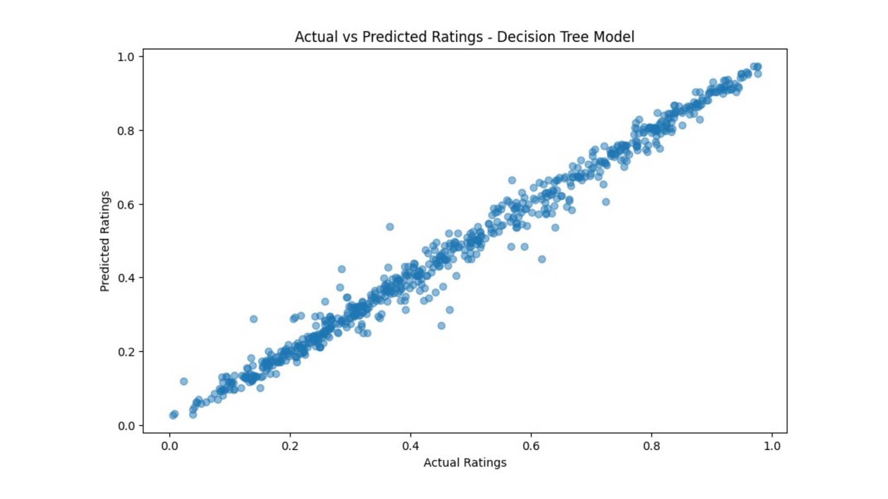

# 🏀 College Basketball Analysis — ML Classification Project

A machine learning project built as the final project for the **Intro to Machine Learning and Data Science** course at [Armenian Code Academy](https://aca.am).

The goal was to analyze NCAA Division I college basketball statistics and predict team tournament outcomes using classification models.

---

## 📊 Dataset

**Source:** `cbb.csv` — College Basketball Dataset (NCAA D1 teams)

The dataset includes season statistics for college basketball teams such as:
- Offensive and defensive efficiency ratings
- Tempo, turnover rates, rebound percentages
- Tournament seed and round results

---

## 🎯 Objective

Predict whether a team advances past a given round in the NCAA tournament based on their regular-season performance metrics.

---

## 🧠 Models Used

- **Logistic Regression**
- **Decision Tree Classifier**

Both models were evaluated using confusion matrices to compare performance.

---

## 📈 Results

| Model | Result |
|---|---|
| Classification model (team strength) | Accuracy **0.90** |
| Rating model — Decision Tree + GridSearchCV | MSE **0.002** |



Predicted vs actual ratings: points lie close to the diagonal, so the model ranks teams well.

Confusion matrices for the tournament-round models: `confusion_matrix.png` (Logistic Regression), `confusion_matrix_tree.png` (Decision Tree).

---

## 🛠 Tech Stack

| Tool | Purpose |
|---|---|
| Python | Core language |
| Pandas | Data loading & preprocessing |
| Scikit-learn | ML models & evaluation |
| Matplotlib / Seaborn | Data visualization |
| Jupyter Notebook | Development environment |

---

## 📁 Project Structure

```
ACA-LastProject/
├── main2.ipynb                    # Main notebook with full analysis
├── cbb.csv                        # Dataset
├── confusion_matrix.png           # Logistic Regression results
├── confusion_matrix_tree.png      # Decision Tree results
└── College Basketball Analysis.pptx  # Project presentation
```

---

## 🚀 How to Run

```bash
# Clone the repo
git clone https://github.com/ZhoraManukyan/ACA-LastProject.git
cd ACA-LastProject

# Install dependencies
pip install pandas scikit-learn matplotlib seaborn jupyter

# Launch the notebook
jupyter notebook main2.ipynb
```

---

## 👤 Author

**Zhora Manukyan**
- GitHub: [@ZhoraManukyan](https://github.com/ZhoraManukyan)
- LinkedIn: [linkedin.com/in/zhora-manukyan](https://linkedin.com/in/zhora-manukyan)
- Email: zhora.a.manukyan@gmail.com

---

*Final project for ACA Intro to ML and Data Science — December 2023*
